# The web console, in pictures

These screenshots were taken from a running server in a real browser while testing the console
(see [design note 006](../design/006-console.md)). Everything was done through the UI. Where a
step touched something outside Forgeline, the notes say what stood in for it.

| Picture | What it shows |
| --- | --- |
| [01-setup](01-setup.png) | First run: the first administrator is created, and the server token proves you control the server |
| [07-overview](07-overview.png) | Pipelines with current status, a sparkline of the last runs, success rate and average time; failing pipelines sort first; platform health strip |
| [04-editor-graph](04-editor-graph.png) | The pipeline editor: line numbers, live validation by the server, and a live graph |
| [30-step-builder](30-step-builder.png) | Adding a step from a form (needs, network, secrets, time limit) instead of writing YAML |
| [31-version-history](31-version-history.png) | Every save is a version; any can be viewed or restored |
| [05-run-live](05-run-live.png) | A run on real Docker: `build` done, `unit-tests` and `lint` running in parallel, logs streaming |
| [06-run-done-masked-secret](06-run-done-masked-secret.png) | The finished run. The step printed its secret; the stored output shows `***` |
| [08-run-failed](08-run-failed.png) | A failure: the failing step is selected, its dependents are skipped, exit code and stderr are shown |
| [10-secrets-list](10-secrets-list.png) | Secrets: name, where stored, which pipelines use it. Values are never shown |
| [32-vault-secret-run](32-vault-secret-run.png) | A secret created in the UI, used by a step built in the UI, with no network, masked in the output |
| [11-people](11-people.png) | People and roles |
| [12-github-form](12-github-form.png), [14](14-github-active-tested.png), [15](15-github-deliveries.png) | Connecting GitHub: repositories and branches, token (write-only), webhook secret (shown once), connection test, and the deliveries list (accepted, ignored, rejected). A stand-in GitHub API served the downloads and received the commit statuses |
| [23-deploy-preview](23-deploy-preview.png) | A cloud change as the approver sees it: reason, validated parameters, and exactly what would be created |
| [25-change-succeeded](25-change-succeeded.png) | The same change after a different administrator approved it and it ran. An AWS stand-in served the calls |
| [26-audit-log](26-audit-log.png) | The audit trail: setup, accounts, proposal, approval, execution |
| [28-overview-dark](28-overview-dark.png), [29-mobile-overview](29-mobile-overview.png) | Dark theme and a phone-width layout |

Also verified in the browser but not pictured here, because the pictures show an AWS account:
the Infrastructure page reading a real account (stacks, instances) with the AWS CLI profile of
the person running the server, and a change proposed against it that its own proposer could not
approve and a second administrator rejected, so nothing in that account changed.

| Picture | What it shows |
| --- | --- |
| [34-actions-runs](34-actions-runs.png) | GitHub Actions page: the workflows of an allowed repository, and its runs with status, branch, event and who started them. A run from a fork carries a `fork` tag. A stand-in GitHub served the data |
| [35-actions-run-log](35-actions-run-log.png) | A failed run: jobs and steps, the end of the job's log (shown as text), and Re-run buttons |
| [36-actions-dispatch](36-actions-dispatch.png) | Starting a workflow: only branches allowed for the repository, optional inputs |
| [37-workflow-step-builder](37-workflow-step-builder.png) | Adding a GitHub Actions workflow step from the form |
| [38-workflow-step-run](38-workflow-step-run.png) | A run with a container step followed by a workflow step, its log showing GitHub's progress. A stand-in GitHub served the calls |

## Assistant looking at an ECS cluster (call_aws)

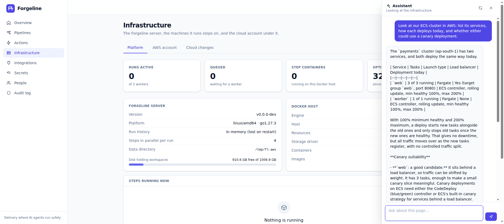

Three read-only `call_aws` lookups (clusters, services, service details) against the AWS stand-in
`scripts/dev/fake-aws`, answered by the real `claude`. Design note 015.

## AWS MCP Server and change proposals

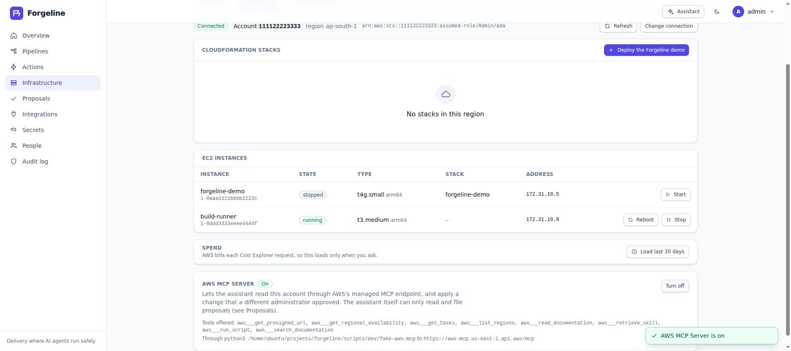

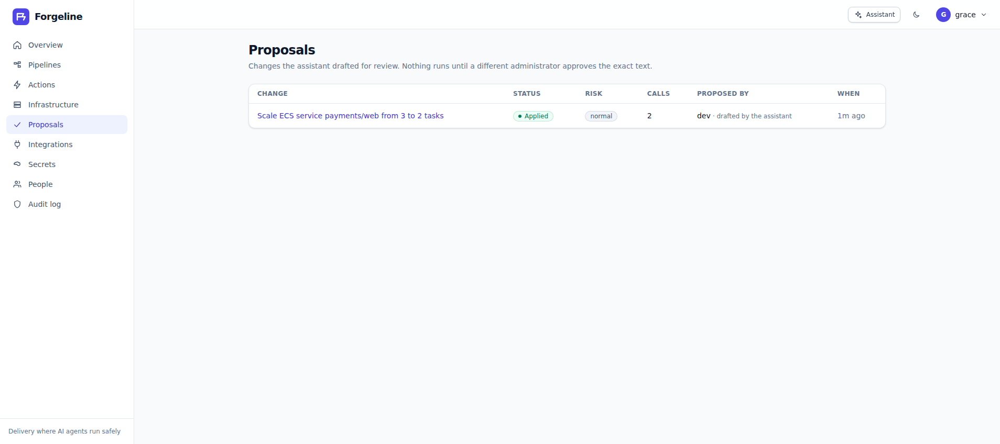

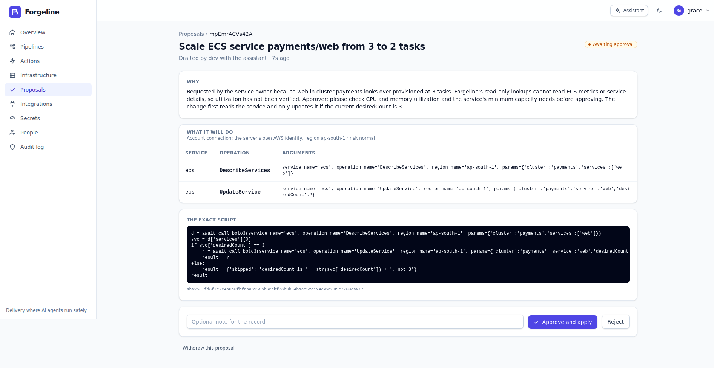

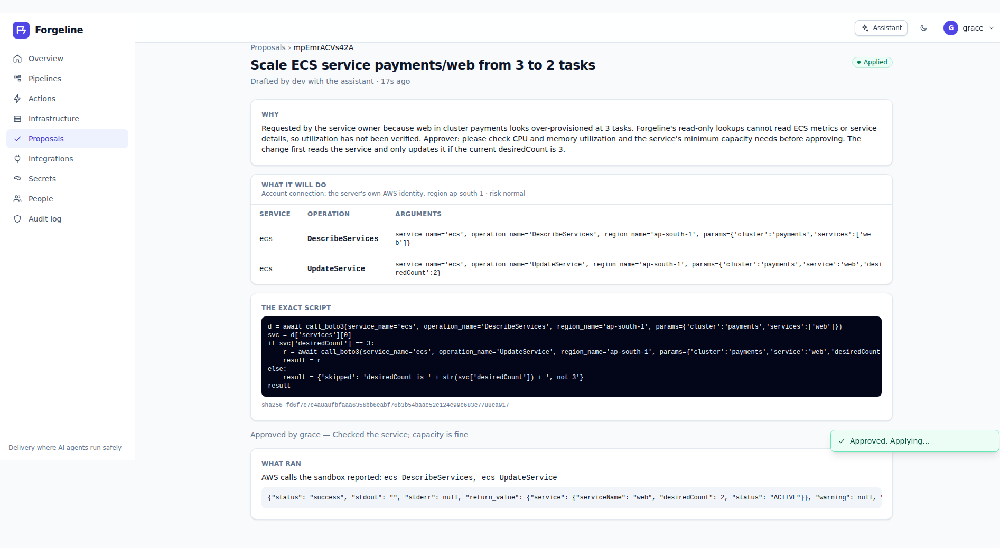

### AWS resource explorer

Infrastructure → AWS account lists everything in the connected account by service (ECS clusters and
services, EC2, Lambda, S3, RDS, DynamoDB, VPCs, load balancers, queues, log groups and more), with
state, search, a detail panel per resource, and a mark on anything an approved proposal changed. It
only reads, and a service the role may not list is named instead of shown as empty.

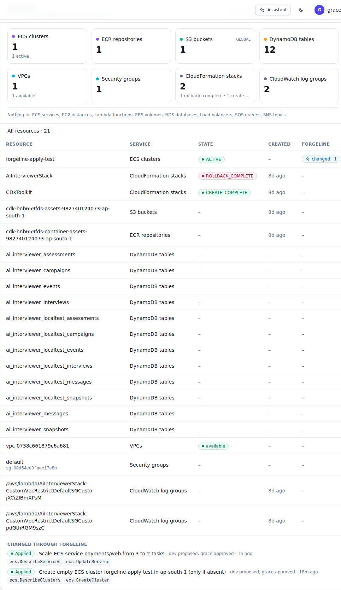

The assistant drafted the change, another administrator approved the exact script, Forgeline applied
it through `scripts/dev/fake-aws-mcp` (a stand-in; design note 016).

### Several AWS accounts

Infrastructure → AWS account has an account switcher. The connection made first is the primary
account; administrators can add more by profile and region (Add account proves the profile with
`sts get-caller-identity`, labels it production, staging, development or sandbox, and refuses an
account that is already added). Every account can be read: the explorer, stacks, spend, and the
assistant (`aws_accounts`, then `aws_summary` or `call_aws` with an `account`). Changes are proposed
for the primary account only; the page says so on the others. Removing an account changes nothing in AWS.

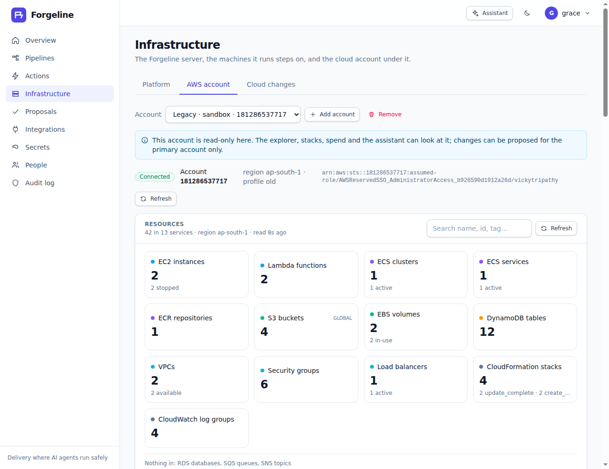

### Agents and skills

The Agents page lists agents and skills. A **skill** is a procedure written in plain steps. An
**agent** is instructions, pinned skill versions, a short list of tools and a tier (T0 advises, T1
may also file change proposals). Every save is a new version with a fingerprint, its author and a
note; the page shows the diff from the previous version, flags when a pinned skill has a newer
version, and can roll back by copying an old version forward. Talk to an agent on its page, pick
any past version to run, or let the assistant hand it work (`ask_agent`). An agent uses only its own
tools, every one of them runs as the person asking, and an agent cannot call another agent.

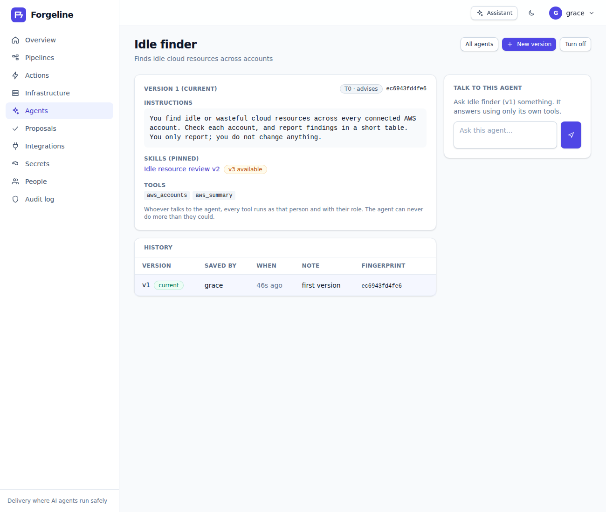

### Workflows

Agents page → Workflows. A workflow is stages run in order; the steps in one stage run at the same
time, and each step is an agent doing one task at the version that was current when the workflow
was saved. A stage can be gated: the run stops there until an administrator releases it. A workflow
runs when someone starts it or on a schedule (every 15 minutes to every week), as viewer or
developer and never as an administrator, because nobody is watching. Each stage's findings are
handed to the next as data. Runs are saved after every stage, so a run waiting at a gate survives a
restart; a run that was mid-stage when the server stopped is marked failed. Anything a step proposes
is an ordinary proposal for a different administrator to approve.

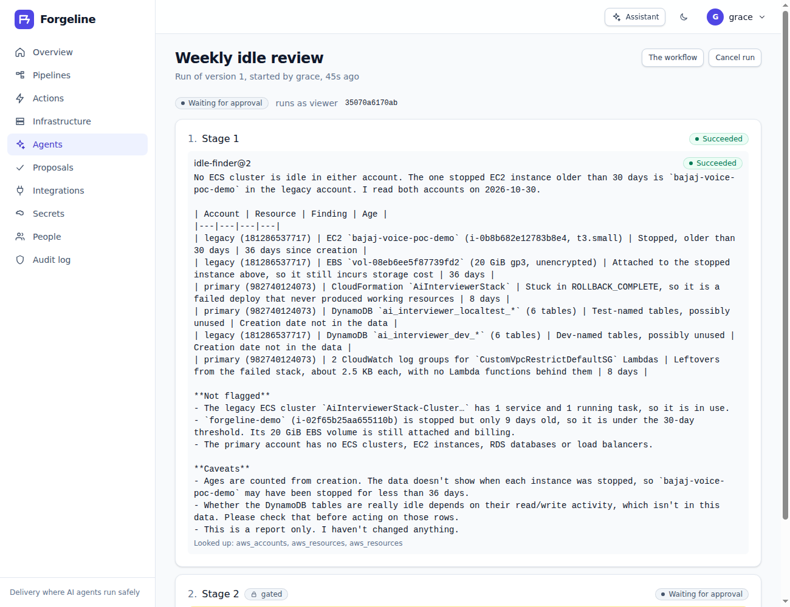

### Why a run failed

A failed run shows **What went wrong** above its steps: the step that failed first, its exit code,
the likely causes (a missing command, a failed test, a timeout, a pull that was refused, rejected
credentials, a network that the step's own `network: none` cut off, and so on), the steps that did
not run because of it, and the end of its output. It is worked out from what the run recorded, needs
no assistant, and **Ask the assistant** goes further when you want it.

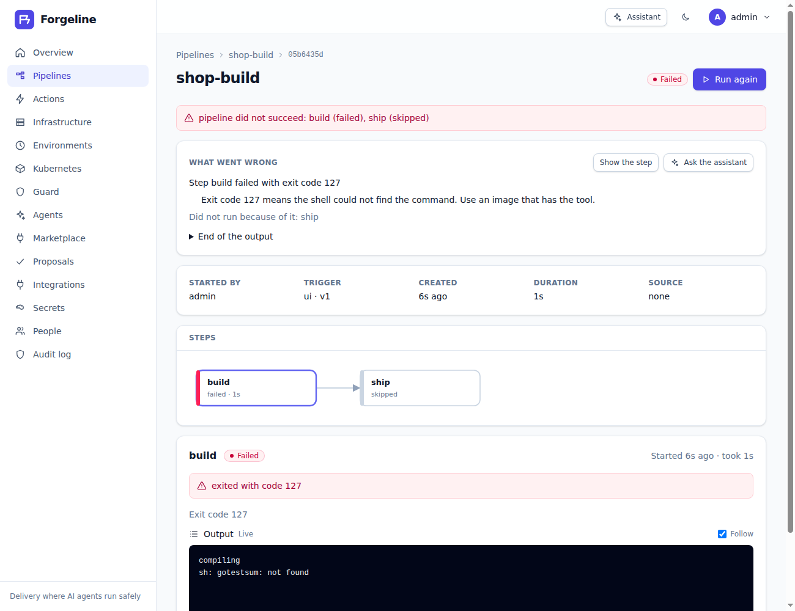

### Guard

The Guard page shows security and hygiene findings across your AWS accounts, worst first, with counts
by severity. **Scan now** (or an automatic scan every 6 hours to a week) reads each account; it never
changes anything. Checks include security groups open to the internet, unencrypted EBS volumes and
databases, public databases, S3 public-access settings, the IAM credential report (root access keys
and MFA, users with a password and no MFA, access keys older than 90 days), deprecated Lambda
runtimes, failed CloudFormation stacks, stopped instances, log groups that never expire, and ECR
repositories that do not scan. A finding keeps its id and first-seen date, moves to Resolved when
the cause is gone, and a check that could not run (usually permissions) never resolves anything and is
named on the page. An administrator can **accept** a finding for 1 to 90 days with a reason everyone
can read; it returns to Open when the time is up. Ask the assistant how to fix one, or give an agent or
workflow the `guard_findings` tool.

**Pipelines and run logs.** Every scan also reads your saved pipelines and the first 2 MB of each step's
log in the 25 newest runs, so it works with no cloud account connected (pick "Pipelines and run
logs" in the filter). It flags an image with no tag or `latest` (high when the step has secrets), a tag
without a digest on a step with secrets, secrets together with open network (more serious for agent
steps), an agent step holding secrets beyond its own login, a credential or secret-looking value
written into the pipeline file, `curl … | sh`, a script that prints a secret, `set -x`/`env` in a step
with secrets, a saved pipeline that no longer validates, and credential formats (AWS keys, GitHub and
Slack tokens, Anthropic keys, private keys, live Stripe keys) in a run log. A finding names the
variable or the kind of credential and never repeats the value. A credential found in a run log
stays open even after its run is old: revoke it, then have an administrator accept the finding with a
note saying so.

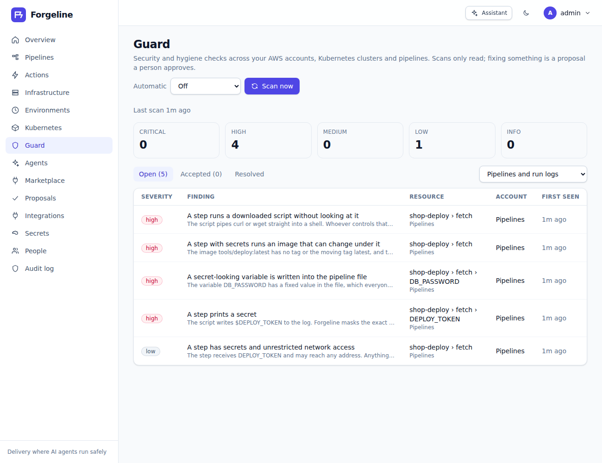

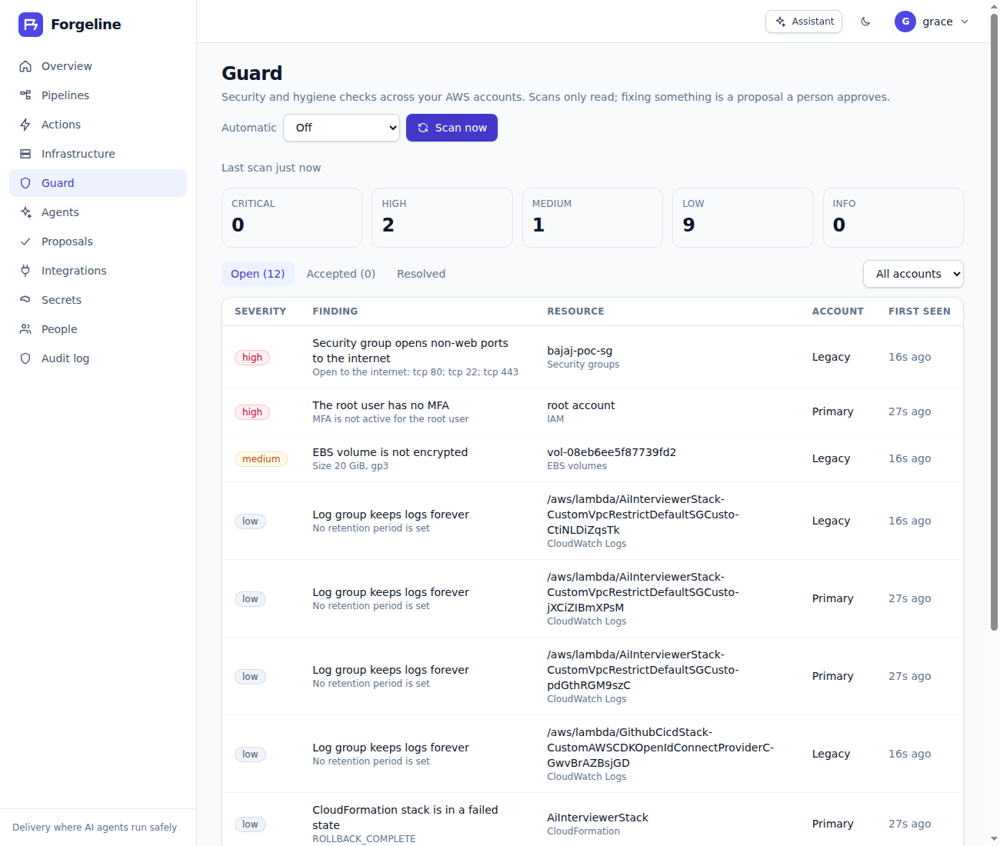

### Kubernetes

Kubernetes → Add cluster. Connect an **EKS** cluster through an AWS account Forgeline already uses
(it asks AWS for a short-lived token, so nothing is stored), or any cluster with a **service-account
token** that can only get, list and watch (stored in the vault, never shown again and never given to
steps). Forgeline proves it can read the cluster before saving. The cluster page is the same explorer
as the AWS account page: nodes, deployments, StatefulSets, DaemonSets, pods, services, namespaces and
warning events, with state, search and detail. Guard scans clusters too, leaving system namespaces
out. Forgeline's client can only send GET requests to fixed paths, so reading is safe by construction.
The assistant, agents and workflows can use `k8s_clusters` and `k8s_resources`.

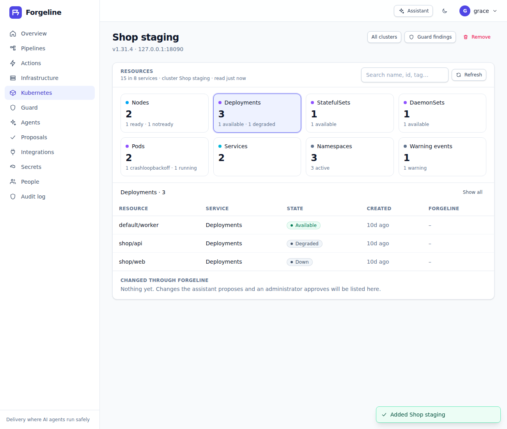

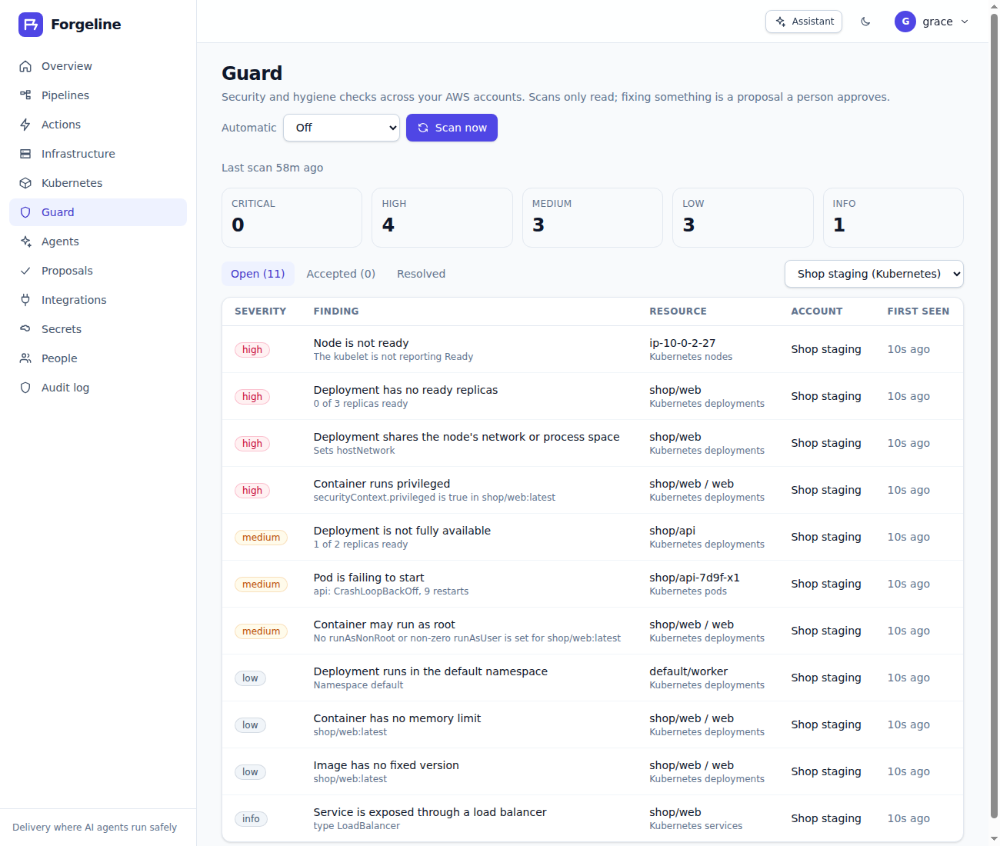

### Environments

Environments → New environment. Choose a **developer box** (a small private EC2 instance with an
encrypted disk and no inbound ports; connect with Session Manager) or a **QA sandbox** (a DynamoDB
table and an encrypted queue), say what it is for and how long to keep it. Before you submit, the form
shows the cost for that time and whether it **starts at once** or **waits for an administrator**.
Waiting ones are approved as any cloud change is (Infrastructure → Cloud changes, where the preview
lists what would be created, and a different administrator approves it). The clock starts when it is
ready. When time is up Forgeline deletes the stack; the owner or an administrator can extend it
(up to the longest life the policy allows) or delete it early; a creation that fails is cleaned up.

Administrators set the **self-service policy**: which templates, how long, how costly, and how many per
person. Inside it, requests start in the name of the policy without a second person, and each step is
in the audit log. It is off until an administrator turns it on.

**Asking the assistant.** The assistant, an agent and a workflow step can request an environment for
you with `environment_templates` (read-only: the templates, prices and settings) and
`request_environment`. It is the same request you would make, in your name, with one difference: it
**never starts on its own**, even when the self-service policy would let you start that template, because no
person has read it yet. A different administrator approves it as any cloud change, and the request's reason
says the assistant asked. The per-person limit counts it. An agent needs `request_environment` in its tool
list and must be review-tier (T1); a workflow that runs on a schedule has no person to own an
environment and can't ask. The assistant's reply and the agent's chat link to Environments, a workflow run lists the environments its
steps asked for, and the Environments page marks them "asked by the assistant".

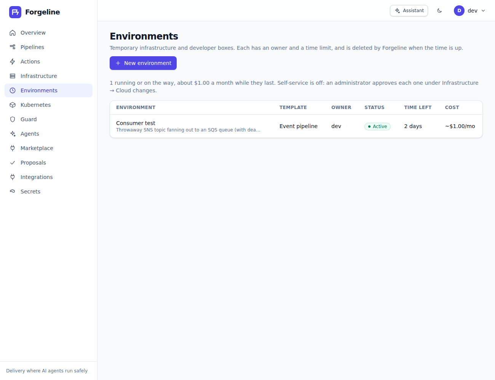

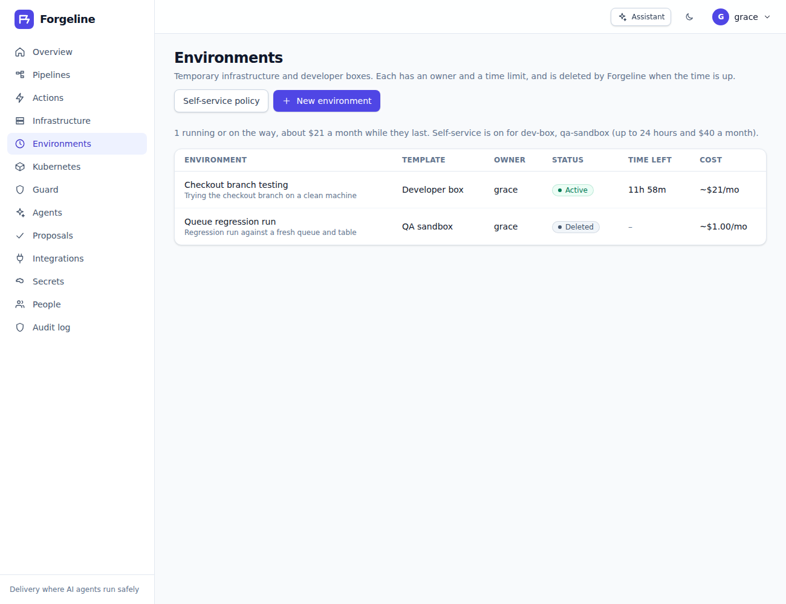

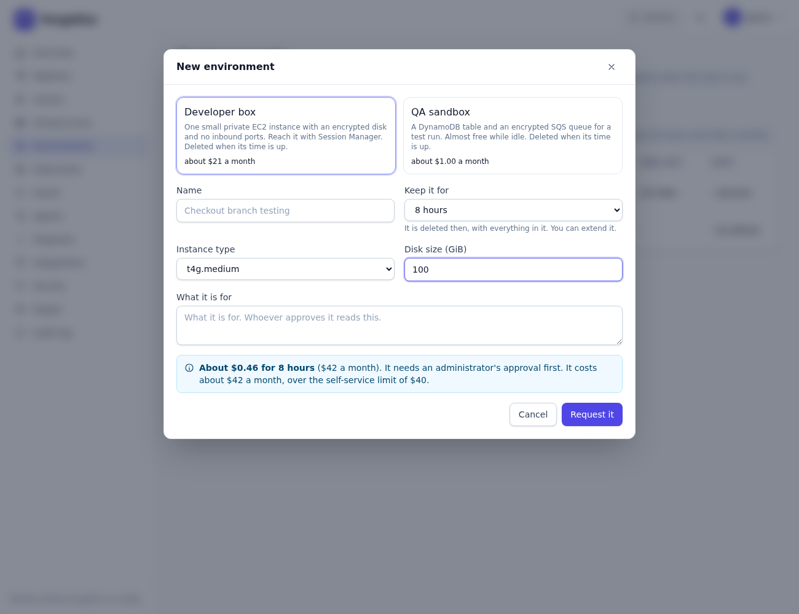

## Marketplace

Ready-made skills and agents. Review shows what each agent may read, the tier it could reach, the
skills it adds and the package fingerprint. Install is pinned to that fingerprint; a package that
changed since you opened it must be reviewed again. Updates add versions and keep the tier.

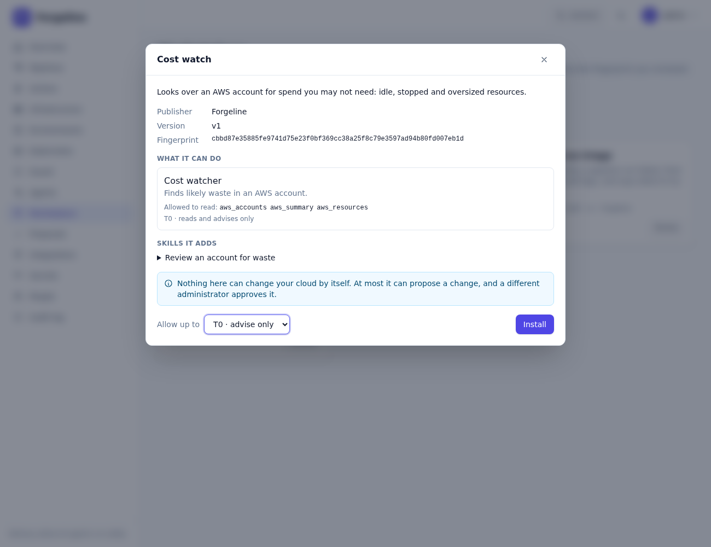

Packages can also carry **plugins**: tools from a container image. Turn them on with the switch at
the top of the page (Docker must answer). The install screen names the image and its tools, and you
choose whether it may use the network and which vault secret it gets for each variable it asks for;
the defaults give it nothing.

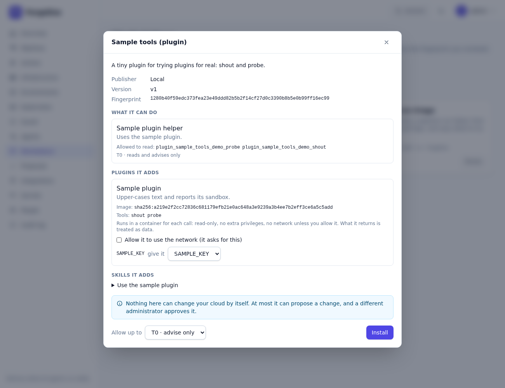
